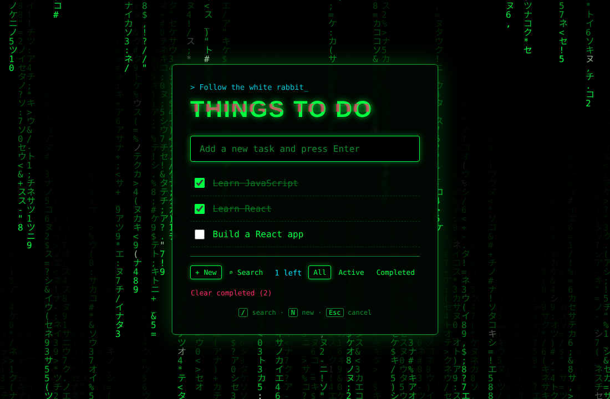

# Things To Do — Matrix edition

A cyberpunk, Matrix-themed to-do list built with React. Originally written in 2022 while I was learning React; rebuilt in 2026.



**Live demo:** https://patcont.github.io/TODO-list-React-App

## Features

- Add, complete, delete and clear completed tasks
- Filter (All / Active / Completed) and live search
- Keyboard first: <kbd>N</kbd> new task, <kbd>/</kbd> search, <kbd>Esc</kbd> cancel
- Tasks persist between visits (`localStorage`)
- Animated "digital rain" drawn on a `<canvas>` (respects *reduced motion*), glitch title, random Matrix quote

## Tech

React 19 (hooks + `useReducer`) · Vite · Vitest · plain CSS · Google Fonts (Orbitron, Share Tech Mono)

## Run it locally

```bash
npm install
npm run dev      # dev server
npm test         # reducer tests
npm run build    # production build in dist/
npm run deploy   # publish to GitHub Pages
```

## What changed in the 2026 rebuild

| Before (2022) | After (2026) |
| --- | --- |
| React 15, `react-scripts` 0.9, `recompose`, Bootstrap 3 | React 19 + Vite, no UI framework |
| `node_modules/` and `build/` committed (~17,000 files) | Only source code is tracked |
| 8.6 MB background GIF | ~80-line canvas animation |
| Class components + HOCs, deprecated lifecycles | Function components, a pure reducer and a custom hook |
| No persistence, no delete | `localStorage`, delete and clear completed |

The original code is preserved in the git history.
